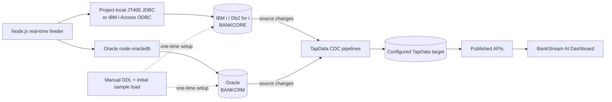

# BankStream Feeder

BankStream demonstrates TapData CDC across IBM i Db2 for i (`BANKCORE`) and Oracle (`BANKCRM`). Responsibilities are separated: `ddl/` contains one-time manual schema setup, `bulk-data/` contains manually executed initial sample records, and `src/` contains only the Node.js connectivity check and continuous real-time feeder.

## Architecture



The feeder writes to IBM i and Oracle through their native connections. TapData is configured separately to capture changes from those databases and move them through its target and published APIs. The feeder does not call TapData. `DATA_SOURCE` choices such as demo data, MongoDB, and TapData belong to the separate dashboard and are not feeder connection modes.

## Prerequisites

- Node.js 20 or later and npm.
- Network access and runtime `SELECT`, `INSERT`, and `UPDATE` privileges for the configured Db2 for i and Oracle databases.
- For IBM i, either a configured IBM i Access ODBC driver/DSN or Java 11+ for the included project-local JT400/JTOpen driver. Oracle uses the Node.js `oracledb` driver in its default thin mode.
- Initial schema creation and sample data loaded manually as described below. TapData is optional for running the feeder and must be configured separately to capture CDC.

## Required execution order

The manual bulk-data scripts describe the reference dataset used by the real-time feeder. If you have already loaded this data, do not run either bulk-data script again; start with the read-only connection check and then run the real-time feeder. Node.js never invokes these scripts or inserts the initial sample data.

1. In [`ddl/01_db2i_schema.sql`](ddl/01_db2i_schema.sql), replace `DB2IRUN` with the existing IBM i profile configured by `DB2I_USER`. Run the setup statements at the top as an IBM i administrator with schema authority, then reconnect as that runtime profile and run the rest of the script starting at `SET CURRENT SCHEMA`. An IBM i administrator must also journal these tables and enable commitment control for the ODBC connection; that platform setup is outside the SQL script.
2. Run [`ddl/02_oracle_schema.sql`](ddl/02_oracle_schema.sql) once using SQL*Plus or SQLcl connected as a DBA to `CDB$ROOT`. The script prompts for the schema password (hidden), target PDB name, and PDB service; it creates `C##BANKCRM`, grants the required schema-owner privileges in that PDB, connects as the owner, and creates the customer profile, KYC, interaction, and offer tables, constraints, and indexes. Change the `USERS` tablespace in the script if your PDB uses a different application tablespace.
3. Execute [`bulk-data/01_db2i_sample_data.sql`](bulk-data/01_db2i_sample_data.sql) manually to load Db2 customers, accounts, transactions, and loans.
4. Execute [`bulk-data/02_oracle_sample_data.sql`](bulk-data/02_oracle_sample_data.sql) manually to load customer profiles, KYC records, interactions, and offers. Match each profile `CUSTOMER_ID` to its `BANKCORE.CUSTOMER.CUSTOMER_ID`.
5. Review the validation queries at the end of each bulk script. Compare the ordered Oracle `CUSTOMER_ID` list to the Db2 customer IDs and confirm expected row counts and no orphan relationships.
6. Configure the runtime credentials, run `npm run dry-run`, then run `npm run realtime` to generate ongoing CDC changes.

DDL is manual and one-time only. Do not rerun DDL during bulk loading or real-time processing. Bulk SQL is also manual and intended for the initial load only; it is not invoked by Node.js. No script contains DELETE, TRUNCATE, table recreation, or cleanup operations.

## DDL and sample data

The Db2 schema uses `CUSTOMER`, `BANK_ACCOUNT`, `ACCOUNT_CUSTOMER_RELATIONSHIP`, `ACCOUNT_TRANSACTION`, and `LOAN_ACCOUNT`. The account-to-customer relationship is read from `ACCOUNT_CUSTOMER_RELATIONSHIP`; the feeder does not assume a customer ID column exists directly in `BANK_ACCOUNT`. Oracle provides `CUSTOMER_PROFILE`, `CUSTOMER_KYC`, `CUSTOMER_INTERACTIONS`, and `CUSTOMER_OFFERS`. Oracle cannot declare a normal foreign key from its profile table to a table in an independent Db2 database; the matching `CUSTOMER_ID` is validated through the separate data validation queries.

The sample SQL has six fictional customers distributed across the United States, United Kingdom, and Australia. It includes country-consistent names, `.com`, `.co.uk`, and `.com.au` example email domains, phone formats, cities, states/regions, street addresses, and postal codes. These are synthetic demo values. Initial transactions and all children reference existing parent keys. The sample transaction amounts are illustrative and do not represent live account statements.

## Node.js real-time feeder

The application does not seed, validate, or provision the initial schema. It only supports:

```sh
npm ci
cp .env.example .env
# Configure credentials and confirm the manual initial load is complete.
npm run dry-run
npm run realtime -- --duration 5m --interval 15s
npm test
```

`dry-run` opens both connections and executes read-only connectivity queries. `realtime` is the only data-writing mode. It inserts pending Db2 transactions, transitions them to completed or rejected, and updates balances only for completed debits/credits. Oracle updates include customer profile and KYC updates, new interactions, and offer status changes. Node performs INSERT and UPDATE operations only; it never executes DDL, bulk loads, or DELETE statements. Cycles start immediately and then wait for the configured interval; a slow cycle delays the next cycle instead of overlapping. Each event finishes or rolls back its active Db2 transaction before shutdown. Ctrl+C stops after the current event and closes both connections.

At the end of every run, including a duration timeout or Ctrl+C, the feeder prints an execution summary with actual elapsed time, interval, completed cycles, status, and insert/update counts for every feeder table (including tables with zero changes). Db2 transactional writes are counted only after commit; Oracle writes are counted after the DML call succeeds with autocommit. Successful operation keys are deduplicated so retrying one event cannot inflate the counts. Failed operations are listed separately with schema/table, operation, and error message; transient attempts that later succeed are not reported as failed operations. Summary totals are calculated from these per-table counts, never estimated from cycle frequency.

### Real-time command options

```sh
# Run for 5 minutes, generating data every 15 seconds
npm run realtime -- --duration 5m --interval 15s

# Run for 30 minutes, generating data every 30 seconds
npm run realtime -- --duration 30m --interval 30s

# Generate 10 events at each 15-second cycle for one hour
npm run realtime -- --duration 1h --interval 15s --events-per-cycle 10

# Continue until Ctrl+C
npm run realtime -- --duration unlimited --interval 15s

# Show options
npm run realtime -- --help
```

Duration accepts positive `s`, `m`, and `h` values or `unlimited`. Interval accepts positive `s`, `m`, and `h` values. Defaults are `5m`, `15s`, and one event per cycle. After each cycle, progress logs report elapsed time, the next cycle delay, successful inserts, successful updates, and failures. Shutdown prints the per-table execution summary. Event failures are logged and counted, then the next scheduled event is attempted.

Set `DB2I_DSN` for a configured IBM i Access ODBC DSN, or set `DB2I_HOST`, `DB2I_SCHEMA`, and optionally `DB2I_DRIVER` for a DSN-less ODBC connection. `DB2I_USER` and `DB2I_PASSWORD` are required for either ODBC mode. The IBM i Access ODBC driver must be installed and registered on the machine running Node.js. Alternatively, use the project-local JT400/JTOpen jar at `db2i_driver/jt400-21.0.6.jar` (the default in `.env.example`) to connect through the included Java bridge; relative jar paths resolve from the project folder, and Java 11 or later is required. This connector does not need a DBeaver driver installation. Set `JAVA_COMMAND` only if Java is not available as `java` on `PATH`; `DB2I_JDBC_URL` can override the default URL. Set `ORACLE_USER`, `ORACLE_PASSWORD`, `ORACLE_CONNECT_STRING`, and `ORACLE_SCHEMA` for the Oracle runtime user and owner of the feeder tables. Oracle SQL uses the configured schema owner explicitly. Tune `RETRY_LIMIT`, `LOG_LEVEL`, and `ALLOW_OVERDRAFT`; runtime duration, interval, and events per cycle are command-line options. At startup, the runtime reads active customer-account pairs from Db2 and maps them to Oracle profiles by `CUSTOMER_ID`; it does not assume a fixed customer count or regenerate primary keys.

## IDs, idempotency, and concurrency

The feeder generates transaction primary keys and event keys from UUIDs (`RT-<uuid>`), which fit the live Db2 `VARCHAR(40)` key/reference columns and remain unique across process restarts and concurrent instances without relying on a resettable counter or an assumed sequence. Oracle interaction IDs use `RTI-<uuid>` in the `VARCHAR2(40)` primary key. A generated event reuses its IDs when an operation is retried; primary-key duplicate handling verifies the matching event/reference before treating it as an already committed retry. The pending transaction insert commits first; its later status transition and account balance update commit atomically in a second Db2 transaction. Pending rows are examined each cycle and resolved after interruptions. Status transitions lock the pending transaction and account rows, so concurrent workers cannot post its balance twice. A status row already completed or rejected is left unchanged.

Oracle changes are committed independently from Db2 because the databases do not share a transaction coordinator; a cross-database event is therefore not atomic. Oracle updates assign new values and do not remove prior records. Database credentials need runtime SELECT, INSERT, and UPDATE privileges on the feeder tables. DDL privileges are not required by Node.js.

## TapData CDC

Start TapData capture on both sources before manual bulk loading if initial inserts should appear in the capture stream; start it before `npm run realtime` to capture live changes. Include the eight banking tables and retain their primary keys. Correlate feeder logs by `event=RT-…` and `transaction=…`. Confirm CDC support for your TapData edition and deployed database versions.

## Tests and troubleshooting

`npm test` runs isolated checks for ID mapping, runtime/DDL separation, SELECT-only dry-run behavior, summary table counts, commit-only accounting, retry deduplication, failed-operation details, graceful shutdown summaries, and the absence of DELETE or destructive SQL across runtime, DDL, and bulk-data files. The tests use mocks and do not write to databases. End-to-end connection and driver behavior should be verified with `npm run dry-run` and a controlled demo environment.

- **Connection failures:** check the IBM i Access ODBC DSN/driver and Oracle service/listener, then run `npm run dry-run`.
- **Missing object/column:** confirm one-time DDL was completed in the intended schema and runtime `BANKCRM` user is connected to the correct Oracle schema.
- **Duplicate primary key in manual sample load:** bulk scripts are initial-load scripts, not repeatable Node seed commands. Do not rerun them against loaded data; inspect existing records without deleting them.
- **Duplicate primary key:** confirm all feeder instances use the current version. The feeder uses UUID keys and verifies existing transaction/interactions on duplicate-key retry; if the duplicate belongs to another record, it is reported as a failure without overwriting that record.
- **Permission error:** grant the runtime account SELECT, INSERT, and UPDATE on the required tables. The feeder does not need DDL privileges or sequence access.
- **Interrupted real-time processing:** rerun `npm run realtime`; committed transaction history is preserved and pending Db2 transactions are recovered on subsequent cycles.
